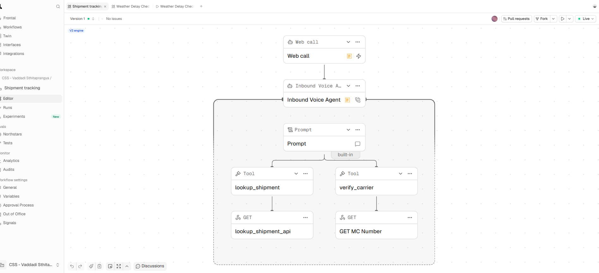
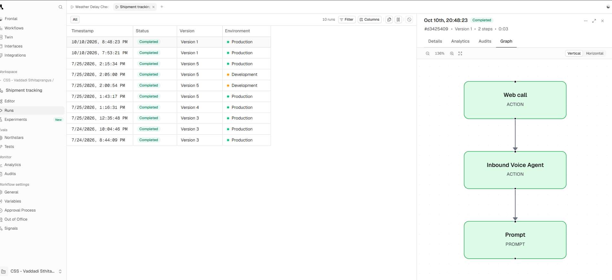

# AI Agent Workflows: Shipment Tracking

An automated AI voice agent that lets a customer get shipment information at any time, without waiting for a person. I designed and built it as a solo project in 2026. It is a demonstration, not a live system with real customers.

## How it works
A customer calls and the agent answers. It follows a written prompt and uses two tools during the call:
- **lookup_shipment:** calls a shipment API and reads back the shipment's status.
- **verify_carrier:** looks up a carrier's MC number through an API to check that the carrier is real.

Why it helps: a customer can call at any hour and get live shipment information, and the support team handles only the cases that need a person.

## What it uses
- Branching logic that changes what the agent does based on what the caller says
- Live lookups from APIs during the conversation

## Screenshots

## Related project
A second agent, the weather delay check, is in its own repository: [weather-delay-check-agent](https://github.com/POVasDATASCIENTIST99/weather-delay-check-agent)

## Limits
- Built to demonstrate the design, not used with real customers.
- The platform and its data sources are not named here.

## Author
Vaddadi Sthitapragnya
